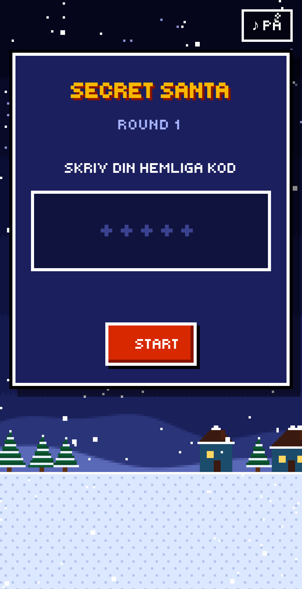
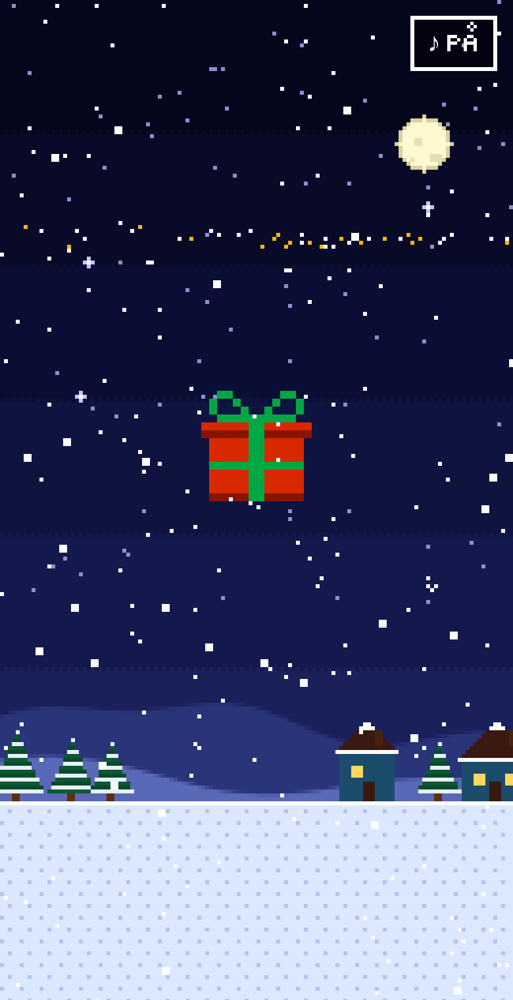
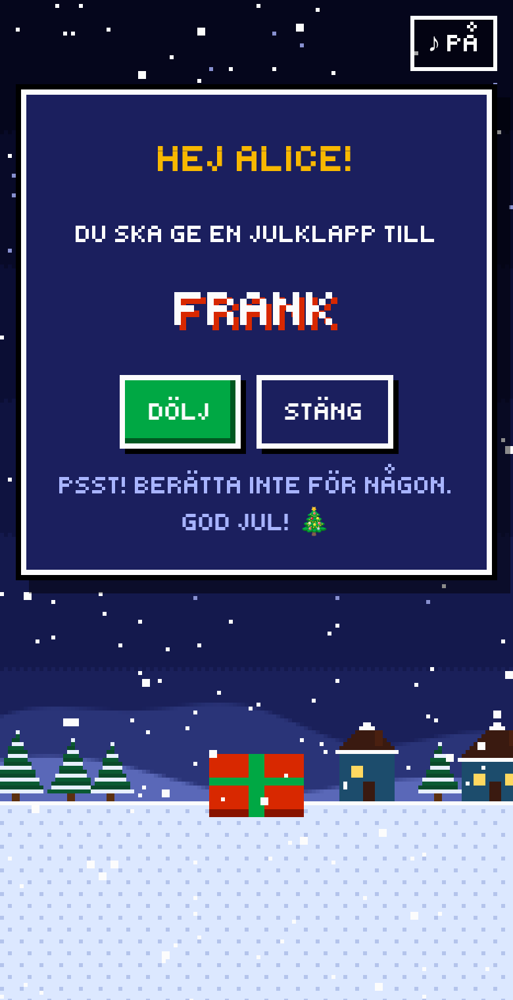

# Secret Santa 🎅

A secret gift draw for the family, served as a static 8-bit web page (GitHub Pages).

<p align="center">
  
  
  
</p>

- Everyone forms **one long chain** (A → B → C → … → A), so there are no swaps.
- Nobody gets someone from **their own family**.
- The page only contains encrypted data. Each person unlocks their recipient with their own code
  (PBKDF2 + AES-GCM, in the browser). Names are encrypted too.
- The script **never** prints who got whom, only name + code. Not even the organizer knows.
- Santa flies in with a gift, you open it and get confetti, with a chiptune version of Jingle Bells
  (Pierpont, 1857, public domain) playing in the background.

The page UI is in Swedish, since that is who it is for.

## Usage

Requires [Deno](https://deno.com).

1. Create `config.ts` (ignored by git, so real names never end up in the public repo):
   ```sh
   cp config.example.ts config.ts
   ```
   Fill in the families, the text message and `baseUrl`.
2. Draw each round:
   ```sh
   deno task draw round1
   deno task draw round2
   ```
   Ready-to-send text messages are printed and saved to `sms/<id>.txt`. The link contains the code
   (`…/round1.html#CODE`), so the input is filled in automatically.
3. Try it locally: `deno task serve`, then open http://localhost:8000/round1.html
4. Commit and push `docs/`. GitHub Pages serves it from *main* `/docs`.
5. Send the messages.

Redrawing requires `--force` and makes the codes you have already sent stop working.

Changed `template.html` (look or sound)? Run `deno task rebuild`. It rebuilds the pages with the
same draw and the same codes.

## How it works

| File                  | Purpose                                                           |
| --------------------- | ----------------------------------------------------------------- |
| `config.ts`           | Rounds, families, text message (local only)                       |
| `lib.ts`              | The draw (rejection sampling → uniform over valid chains), crypto |
| `draw.ts`             | Draws a round, encrypts it into `docs/<id>.html`, writes `sms/`   |
| `rebuild.ts`          | Re-applies `template.html` to existing pages, keeping the draw    |
| `template.html`       | The page: canvas pixel scene, sprites, WebAudio synth, decryption |
| `template-index.html` | The landing page with one button per round                        |
| `stats.ts`            | Draws many times and shows the distribution                       |

`deno task test` runs the tests.

## Security notes

The codes are 5 characters (≈ 28 million combinations) and every guess costs a 150 000-round
PBKDF2. That is plenty for a family game, but someone determined with a GPU and a script could
brute-force it. `sms/` together with the page reveals the whole draw, so don't share it.
